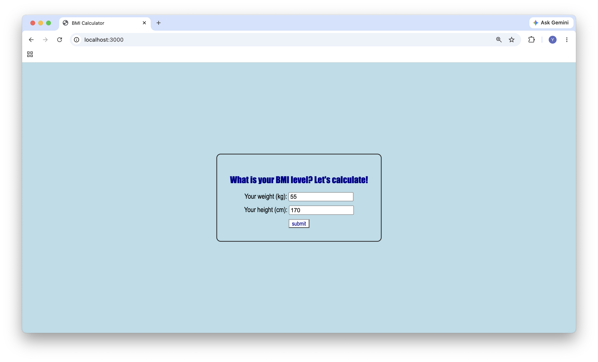
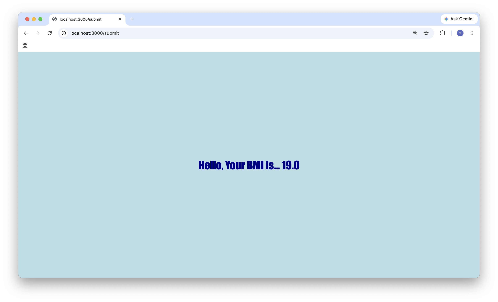

# BMI Calculator

course work:
A simple web app built with Node.js and Express. The user enters a weight and a height, and the server calculates the BMI and returns the result.

## Screenshots





## Features

- Form to enter weight (kg) and height (cm)
- BMI is calculated on the server and rounded to one decimal place
- Missing or non-numeric input returns a 400 status with an error message
- Styled with CSS served through express.static

## Tech Stack

- Node.js
- Express
- HTML and CSS


## How to Run

1. Clone the repository

```
git clone [repository URL]
cd [folder name]
```

2. Install dependencies

```
npm install
```

3. Start the server

```
node main.js
```

4. Open http://localhost:3000 in a browser